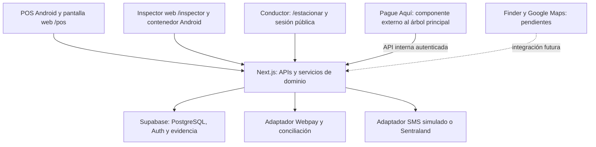

# ParkFacil Smart Parking Finder

**Última actualización:** 2026-10-27, America/Santiago.  
**Autor de esta revisión:** Codex. **Solicitud:** [SOL-2026-10-27-002](solicitudes/SOL-2026-10-27-002/README.md).  
**Repositorio examinado:** `yonels/parkfacil-2027`. Rama local `feature/pago-liberado`, HEAD `9b664c0da7e9925841641d77521d497d00e4bb39`, con cambios locales preexistentes. Esta revisión incluye el árbol de trabajo; no atribuye todos sus archivos al commit indicado.

## 1. Descripción, objetivos y límites

Smart Parking Finder se utiliza aquí como nombre del proyecto que busca unir descubrimiento de estacionamientos, operación de terreno, fiscalización y pago digital de ParkFacil. **No se encontró una implementación identificable con ese nombre ni un buscador público de disponibilidad geográfica en las fuentes examinadas.** La operación POS, Inspector y On Street sí tiene componentes concretos; no equivale a tener terminado el Finder.

Objetivos del producto, sujetos a definición y aceptación:

- Permitir al conductor encontrar estacionamientos y conocer ubicación, tarifas y disponibilidad con fecha de actualización.
- Conectar la operación del POS con entradas, salidas, cobros y turnos.
- Permitir al inspector consultar patentes y registrar fiscalizaciones con evidencia.
- Emitir avisos de cortesía y notificaciones trazables, distinguiendo simulación, aceptación del proveedor y entrega.
- Integrar consulta y pago digital, sin confundir una estadía Off Street con una sesión prepaga On Street.
- Incorporar cartografía y navegación; Google Maps permanece pendiente de implementación verificada.

No se considera implementado: ocupación detectada por sensores, reserva de plazas, predicción de disponibilidad, navegación Google Maps, sanciones municipales o pago automático de multas de cortesía. No se encontraron evidencias suficientes para esas afirmaciones.

### Convenciones de evidencia

| Estado | Significado en este documento |
|---|---|
| Implementado localmente | Se identifica código o configuración en el árbol examinado. |
| Probado localmente | Hay ejecución verificable; se indica fecha, alcance y resultado. Un test con dobles no acredita integración real. |
| Integración identificada | Hay contratos/adaptadores entre componentes. No prueba que los servicios externos estén activos. |
| Validado en hardware | Se identifica equipo y alcance físico probado. No se extrapola a otros flujos. |
| Publicado documentado | Existe evidencia histórica de commit/destino en los registros. No implica una consulta al despliegue actual. |
| Pendiente / no verificado | Falta implementación identificable o evidencia del resultado. |

Esta tarea no consultó bases ni servicios de producción, no verificó variables remotas y no ejecutó pagos, SMS ni instalaciones.

## 2. Arquitectura y tecnologías utilizadas



| Capa | Tecnología / fuente | Observaciones |
|---|---|---|
| Aplicación web y APIs | Next.js 16.2.11, React 19.2.4, JavaScript, App Router | Versiones declaradas en `package.json`, no auditoría de instalación o dependencias remotas. |
| UI | Tailwind CSS 4, Lucide | Interfaces administrativas, públicas, POS e Inspector. |
| Datos y autenticación | `@supabase/supabase-js`, SQL/RPC y migraciones | `src/lib/supabaseServer.js`, `supabaseBrowser.js`, `auth/` y `supabase/migrations/`. Una migración en disco no demuestra aplicación remota. |
| POS nativo | Kotlin/Android, WebView y bridge de dispositivo | Repo separado `yonels/parkfacil-pos-android`; no confundirlo con el `android/` local del Inspector. |
| Inspector Android | Capacitor 8, cámara y plugin de impresora | `capacitor.config.json`, `capacitor-inspector-android/`, `src/lib/inspector/printerAdapter.js`. |
| Pagos | `transbank-sdk`, servicios Webpay; TUU en bridge POS | Autorización, persistencia y conciliación deben verificarse por canal. |
| SMS | Adaptadores SIMULATED / SENTRALAND | `src/lib/onStreetSmsProviderCore.mjs`, `src/lib/sms/`. No se presupone proveedor activo. |
| Evidencia y lectura | Cámara, QR, OCR local con Tesseract; GPS según configuración | Tener librería o permiso no implica validación física completa. |
| Exportación | ExcelJS | No prueba por sí solo un reporte específico de Finder. |
| Ejecución programada | Configuración Vercel | `vercel.json` declara proceso SMS cada minuto y conciliación On Street cada dos minutos; actividad remota no verificada en esta revisión. |

El navegador no debe recibir la clave administrativa de Supabase. El servidor examinado obtiene `SUPABASE_SERVICE_ROLE_KEY`; las rutas deben aplicar autorización y alcance por empresa antes de acceder a datos privilegiados. Esta revisión identifica esos mecanismos, sin certificar cobertura de seguridad completa.

## 3. Operador POS NEO8 / PRO2

La denominación del usuario es «NEO8 Pro2»; el equipo de la instalación documentada se identifica por ADB como **P8_Neo / D1**, SN terminado en **8984**. No se asume que todos los modelos sean equivalentes.

| Funcionalidad | Evidencia identificable | Límite de validación |
|---|---|---|
| Acceso y operación por turno | `src/components/pos/PosTerminal.js`, `src/app/api/pos/`, `src/lib/posShiftService.js` | Hay cambios locales ajenos en servicios de turnos. No se certifica su publicación actual. |
| Entrada, salida y búsqueda de estadías | `PosTerminal.js` y pruebas `PosTerminal.entryV2.contract`, `salidaSearch`, `qrExit.contract` | Código y tests existentes; no se repitió ciclo operativo completo en esta tarea. |
| Patente, fotografía y lectura QR | `src/lib/pos/`, pruebas `platePhoto`, `entryTicket` y escáner nativo | Depende de permisos y configuración del estacionamiento. |
| Tickets e impresión | Bridge Android y agente local; clientes Kozen/SUNMI en repo nativo | La disponibilidad de cada impresora debe probarse en el hardware objetivo. |
| GPS en ticket de entrada | Registro [SOL-2026-10-21-002](solicitudes/SOL-2026-10-21-002/README.md) | Evidencia histórica de versión 1.0.1; no se repitió impresión en 1.0.2. |
| Efectivo, integración TUU y boleta | `PosTerminal.js`, `src/lib/pos/`, registros TUU y DTE | Registros distinguen boleta validada y cobro real con tarjeta pendiente; no presentar ambos como igualmente cerrados. |

**Versión nativa reciente:** [SOL-2026-10-27-001](solicitudes/SOL-2026-10-27-001/README.md) registra commit/push `c9948ee` en rama `fix/auditoria-apk-certificado` del repositorio Android, candidata **1.0.2 / código 33**, 61 pruebas JVM aprobadas, firma verificada e instalación limpia autorizada en el equipo …8984. Se verificó arranque y carga del login. No se verificaron cobros, impresión, cámara ni GPS después de esa reinstalación; no hay aprobación Haulmer documentada para la candidata.

El certificado cambió para incorporar OU/ST. La actualización conservando datos fue rechazada por Android y se realizó reinstalación limpia con autorización. La copia de una APK no respalda sesiones ni resultados de pago locales. Esto debe formar parte del plan de distribución y reversión.

## 4. Inspector móvil

Fuentes principales: `src/app/inspector/`, `src/components/inspector/`, `src/app/api/inspector/`, `src/lib/inspector/` y `src/lib/auth/inspectorAuthorization.js`.

- Consulta de patente y estado de sesión, con llamadas reales al backend.
- Registro de fiscalizaciones `OVERSTAY`, `NO_SESSION` y `OTHER`; asociación a sesión o contexto de estacionamiento validado por servidor.
- Observaciones, evidencia fotográfica y coordenadas cuando estén disponibles/autorizadas.
- Listado, detalle e historial de fiscalizaciones; reporte de SMS y consulta de estado de entrega con alcance autorizado.
- Ticket de cortesía y reimpresión; transporte de impresión desacoplado de la UI.
- Interfaz web instalable y contenedor Android identificado como `cl.parkfacil.inspector`.

**Limitaciones explícitas:**

- `InspectorMapa.js` es una maqueta: contadores fijos 12/3/7 y lienzo sin proveedor cartográfico.
- `InspectorSync.js` simula una operación con temporizador; no implementa una cola offline persistente ni reconciliación real.
- La existencia de pantallas «Morosos», mapa o sincronización no acredita un flujo de cobro, geolocalización en vivo u operación sin conexión.
- `capacitor.config.json` apunta a `https://root.parkfacilapp.cl/inspector/login`. Es configuración local que puede dirigir un dispositivo a producción, no prueba de despliegue ni de una prueba segura en QA.

## 5. Avisos de cortesía y SMS

`inspectorInspectionService.js` vuelve a consultar estado, patente y contexto; `OVERSTAY` exige una sesión realmente vencida. Para el aviso correspondiente se exige además confirmación deliberada de que el vehículo sigue presente. Vencer una sesión no basta para afirmar que se envió una fiscalización por SMS. El servicio utiliza una RPC y claves de idempotencia para evitar repetir el registro y el intento de envío en el mismo flujo.

`courtesyTicketEscPos.mjs` genera bytes ESC/POS y un folio corto derivado del ID real de fiscalización. El formato contiene «MULTA DE CORTESIA»; **ese texto no constituye evidencia de una sanción legal, una deuda exigible o un mecanismo de pago de multas implementado**. La reimpresión debe conservar patente, fecha y folio del registro original.

| Canal | Implementación identificada | Condición para darlo por operativo |
|---|---|---|
| Impresión Android | Plugin Capacitor `ParkFacilPrinter` y adaptador; MTP-II mediante Bluetooth Classic SPP | Probar emparejamiento, permisos, reconexión y ticket en impresora objetivo. |
| Impresión PC | Adaptador al agente local | Agente configurado y disponible; no equivale a Bluetooth web. |
| SMS simulado | `simulatedSmsProvider` devuelve identificador `simulated-*` | No envía un mensaje real, aunque el estado interno sea SENT. |
| SMS Sentraland | Adaptador de token, envío y consulta DLR | Credenciales, saldo, alcance, privacidad y entrega real verificables. |
| Seguimiento de entrega | `inspectorSmsDeliveryService.js`, reportes y endpoints DLR | SENT/aceptado no equivale a entregado al teléfono. Consultar/persistir DLR sin reenviar. |

Los avisos de expiración de On Street y los SMS asociados a una fiscalización son flujos diferentes. Hay código y migraciones de aviso T-15; no debe aplicarse automáticamente la regla histórica de diez minutos del documento piloto a todos los entornos.

## 6. Consulta y pago mediante Pague Aquí

En este repositorio se identifican los contratos de servidor:

- `POST /api/pague-aqui/quote`: cotiza por `stayId` mediante `parkingStayQuoteService.js`.
- `POST /api/pague-aqui/webpay/accredit`: acredita mediante `webpayStayAccreditation.js` y RPC `accredit_webpay_parking_stay`.
- Ambas rutas exigen `x-parkfacil-service-key`; no son APIs públicas para invocar directamente desde el navegador con un secreto embebido.
- La acreditación contempla conflictos, monto diferente, cotización obsoleta y resultado ambiguo. El contrato declara proveedor TRANSBANK/producto WEBPAY_PLUS; no sustituye la autorización comprobada del proveedor por datos del cliente.

No se encontró la página pública `/pague-aqui` dentro del `src/app` examinado de este repositorio. Los registros y fuentes del CRM ParkFacil V2 sitúan allí el canal público: es una integración entre repositorios, no una pantalla que pueda darse por entregada únicamente por estas dos rutas. Su estado actual de producción no se verificó en esta tarea.

Separar tres casos:

1. **Off Street:** cotizar/acreditar una estadía persistida.
2. **On Street prepago:** crear intención, autorizar Webpay y crear/extender la sesión mediante sus servicios propios.
3. **Fiscalización de cortesía:** registro informativo; no se encontró una integración completa que convierta cualquier ticket de cortesía en deuda pagable por Pague Aquí.

La consulta por patente, protección contra enumeración, conciliación cruzada y comprobante deben probarse de extremo a extremo antes de afirmar cobertura completa del canal público.

## 7. Integración con On Street y Supabase

El código On Street reutiliza la jerarquía de empresa/estacionamiento y `parkings → parking_sectors → parking_streets → parking_street_segments`. `on_street_qr_locations` asocia códigos QR a ubicación; sesiones, extensiones, notificaciones, intenciones y transacciones conservan trazabilidad separada.

Fuentes: `onStreetPilotRepository.js`, `onStreetPaymentService.js`, `onStreetPaymentReconcileService.js`, `onStreetAdminRepository.js`, APIs `/api/public/on-street/`, páginas `/estacionar/` y `/on-street-qr/`.

- Hay rutas públicas con tokens y rutas administrativas con autorización; revisar exposición mínima y límites por empresa.
- El inspector consulta estado y registra fiscalización a través de servicios/RPC, no mediante datos confiados del formulario.
- El pago debe confirmarse antes de acreditar tiempo; reconciliación y reintentos no deben duplicar pagos, sesiones ni extensiones.
- Evidencia de inspección dispone de repositorio y migración propios; comprobar permisos de almacenamiento y retención.
- Hay SQL de infraestructura en `supabase/migrations/`; no se aplicó ni verificó ninguna migración remota en esta revisión.
- No se propone una base independiente para Finder: debe diseñarse su contrato sobre el modelo y aislamiento existentes.

La disponibilidad del Finder todavía requiere definir su fuente de verdad. Un contador de sesiones o una capacidad declarada no demuestra plazas físicas libres; también hacen falta frescura, reglas de ocupación y tratamiento de datos desconocidos.

## 8. Google Maps

**Estado: pendiente de implementación identificable.** La búsqueda de referencias de Google Maps, su SDK/API y configuración específica no encontró integración en las fuentes revisadas. El mapa del inspector es explícitamente una maqueta; `next/font/google` no es una integración cartográfica.

Diseño pendiente, no funcionalidad entregada:

- Definir mapa público del conductor y mapa operativo del inspector como necesidades distintas.
- Validar coordenadas, origen de disponibilidad, filtros y actualización; distinguir disponible, ocupado y desconocido.
- Seleccionar productos de Google Maps necesarios y estimar consumo antes de habilitar facturación.
- Restringir claves por aplicación/origen/API y separar secretos del servidor.
- Definir navegación externa o embebida, permisos de ubicación, privacidad, accesibilidad y alternativa si falla el mapa.
- Probar mapa, marcadores y navegación con datos controlados; no publicar una maqueta como disponibilidad real.

## 9. Avance por módulos: estimación provisional

**Estimación de preparación técnica del alcance base: 54 %.** Es juicio de ingeniería para planificación, no un porcentaje medido de requisitos aceptados ni disponibilidad de producción. El alcance completo del Finder no está formalizado; esta cifra debe recalcularse al aprobarlo. Tener operación previa avanzada no significa tener implementado el buscador geográfico.

Se usan ocho módulos y pesos explícitos. La valoración combina código, pruebas disponibles, integración y evidencia operativa; penaliza los flujos pendientes. No representa cobertura de tests. Las cifras por módulo son estimaciones, separadas de los hechos descritos en las secciones anteriores.

| Módulo | Peso | Avance estimado | Aporte al total | Brecha principal |
|---|---:|---:|---:|---|
| POS y dispositivo | 20 % | 80 % | 16 puntos | Auditoría de candidata y prueba operativa completa tras reinstalación. |
| Inspector móvil | 20 % | 65 % | 13 puntos | Mapa/offline y validación de campo completa. |
| Cortesía e impresión | 10 % | 60 % | 6 puntos | Matriz de hardware, alcance jurídico y recuperación. |
| SMS y entrega | 10 % | 60 % | 6 puntos | Evidencia de envío/entrega real por entorno y operación continua. |
| Pague Aquí e integración pública | 10 % | 60 % | 6 puntos | E2E entre repositorios; no se acredita pago de multas. |
| On Street, datos y autorización | 10 % | 70 % | 7 puntos | Verificar esquema, aislamiento y conciliación del despliegue objetivo. |
| Google Maps | 10 % | 0 % | 0 puntos | Integración no identificada. |
| Finder público y disponibilidad | 10 % | 0 % | 0 puntos | Contrato, datos de ocupación y buscador pendientes. |
| **Total** | **100 %** | — | **54 puntos / 100** | No es certificación para producción. |

### Separación de entornos

| Entorno/evidencia | Situación al 2026-10-27 |
|---|---|
| Desarrollo local | Componentes concretos identificados; árbol con cambios pendientes ajenos. No se cambió código en esta tarea. |
| Pruebas de esta revisión | 100 tests locales aprobados en cinco archivos; véase sección 11. No hubo E2E ni acceso a proveedores. |
| Integración | Contratos Webpay/SMS/Supabase y bridge nativo presentes. Activación y compatibilidad de todos los despliegues no verificadas. |
| Hardware | Registro de arranque/login de APK POS1.0.2 en …8984; no validación integral del Finder. |
| Producción histórica | SOL-2026-10-21-002 registra publicación de plataforma y APK previa. Su estado de cobro tarjeta seguía pendiente en la evidencia citada. |
| Finder / Google Maps en producción | No documentado ni verificado. |

## 10. Pendientes, prioridades y próximos pasos

| Prioridad | Trabajo | Criterio de aceptación |
|---|---|---|
| P0 | Formalizar alcance de Finder y matriz de requisitos | Usuarios, búsqueda, disponibilidad, pago, datos y criterios medibles aprobados. |
| P0 | Inventariar versiones, migraciones y variables por entorno con autorización | Matriz repo/commit/despliegue/esquema verificable; sin confundir árbol local con producción. |
| P0 | Cerrar firma y auditoría POS con Haulmer | Certificado aceptado, justificación LAUNCHER atendida y plan de actualización/reversión probado. |
| P0 | E2E financiero en ambiente de pruebas | Pago aprobado/rechazado/duplicado/timeout/retorno perdido sin doble acreditación; resultados pendientes recuperables. |
| P0 | Revisar aislamiento, datos personales y secretos | Acceso por empresa/rol, mínimos públicos, permisos de evidencia y ausencia de secretos en cliente/logs. |
| P1 | Definir ocupación real y su frescura | API de disponibilidad con origen, timestamp, capacidad y estado desconocido verificables. |
| P1 | Implementar Finder y Google Maps | Búsqueda, filtros, mapa/navegación y fallos controlados con datos de prueba. |
| P1 | Probar Inspector y SMS en campo | Consulta, registro único, foto/GPS, impresión, SMS real y DLR comprobados. |
| P1 | Cerrar Pague Aquí entre repositorios | Consulta, cotización, pago, acreditación y comprobante consistentes en ambos lados. |
| P2 | Diseñar operación offline real | Cola persistente, reintentos, reconciliación y resolución de conflictos; reemplazar simulación. |
| P2 | Consolidar reportes y documentación vigente | Indicadores definidos, sin contadores ficticios ni documentos piloto presentados como estado final. |

Próximo paso recomendado: aprobar la matriz de alcance y el inventario de evidencias antes de convertir esta estimación en cronograma. Esta documentación no autoriza desarrollo adicional, activaciones ni publicaciones.

## 11. Riesgos, pruebas y condiciones de implementación

### Riesgos y controles

- **Disponibilidad ficticia:** mapa y contadores simulados no deben presentarse como datos en vivo.
- **Cambio de certificado POS:** puede exigir reinstalación y pérdida de datos locales; preservar APK/clave original, respaldos y procedimiento autorizado.
- **Pagos y desconexión:** conservar idempotencia y recuperar resultados pendientes antes de borrar datos o repetir cobros.
- **SMS:** SIMULATED no acredita envío; SENT no acredita entrega. DLR, fallos, duplicados y costos requieren operación trazable.
- **Privacidad:** patentes, teléfonos, fotos y ubicación requieren acceso limitado, retención definida y registros sin secretos.
- **Legal:** la leyenda «multa» no demuestra potestad sancionatoria ni deuda. Validar terminología y reglas antes de un uso sancionatorio o de cobranza.
- **Hardware:** distinguir POS/impresora, Android nativo, navegador/PWA y PC; no asumir que Bluetooth de navegador sustituye al plugin SPP.
- **Desvío entre ramas y producción:** el árbol local contiene cambios no publicados; los registros históricos no sustituyen la verificación actual autorizada.

### Pruebas ejecutadas en esta revisión

Fecha: **2026-10-27**. Comando local, sin base ni proveedores reales:

```powershell
node --test src/lib/inspector/courtesyTicketEscPos.test.mjs src/lib/inspector/inspectorSmsStatusMessage.test.mjs src/lib/inspector/inspectorPlateStateCore.test.mjs src/lib/onStreetPaymentReconcileCore.test.mjs src/lib/sms/sentralandCore.test.mjs
```

Resultado: **100 pruebas aprobadas, 0 fallos**. Cubren formato de cortesía, estado de patente, comunicación de estados SMS, núcleo de conciliación y adaptador Sentraland con respuestas simuladas. No demuestran entrega SMS, pago real, esquema remoto ni compatibilidad física. No se ejecutó build/lint completo por tratarse de documentación; no se atribuyen resultados actuales a comprobaciones históricas.

Condiciones antes de implementar/distribuir nuevos módulos: alcance aprobado, entorno QA aislado, respaldo verificable, revisión de seguridad y privacidad, pruebas financieras idempotentes, prueba de hardware, monitoreo, reversión ensayada y autorización expresa para cada publicación/migración o comunicación real.

## 12. Diferencias entre documentación y código

| Fuente o afirmación | Diferencia observada | Tratamiento |
|---|---|---|
| `MasterProjectDocument.md`: fundación sin tablas/migraciones | El árbol actual contiene servicios, módulos y numerosas migraciones. | Conservar como documento histórico, no como resumen actual. |
| `PILOTO-ON-STREET-QR.md`: sin Webpay/proveedor SMS real/cron | Existen servicios Webpay, adaptador Sentraland y `vercel.json` con crons. | Separar etapa piloto de implementación posterior; activación remota no verificada. |
| Piloto: aviso diez minutos antes | Hay migraciones y servicios posteriores asociados a T-15. | Verificar configuración/esquema del destino; no afirmar regla uniforme. |
| Inspector: nombre de vista «Mapa» / «Sincronización» | Código explícitamente simulado. | Pendiente, sin integración Google Maps ni cola offline real. |
| Supuesto Finder ya implementado | No se encontró módulo/buscador identificado ni disponibilidad geográfica pública. | Objetivo pendiente, separado de módulos operativos existentes. |
| «Pague Aquí paga multas de cortesía» | Se identifican contratos de estadías y prepago On Street, no ese ciclo integral. | No declararlo implementado. |
| APK1.0.2 instalada = POS validado completo | Registro acredita instalación/arranque/login; no repitió pagos/impresión. | Limitar la evidencia a ese alcance. |

No se sobrescribieron documentos anteriores para ocultar estas diferencias.

## 13. Historial y referencias

| Fecha | Intervención |
|---|---|
| 2026-10-27 | Codex: primera versión del documento; revisión de fuentes, 100 tests locales, estimación provisional y diferencias. Sin operaciones Git remotas, commit, merge, publicación, despliegue ni cambios de base. |

Referencias del repositorio:

- [Documento maestro histórico](MasterProjectDocument.md).
- [Piloto On Street QR](PILOTO-ON-STREET-QR.md).
- [Diseño José Galaz On Street](PROYECTO-JOSE-GALAZ-ON-STREET.md): requisitos/diseño, no evidencia suficiente de implementación.
- [Publicación plataforma/POS y pendientes](solicitudes/SOL-2026-10-21-002/README.md).
- [Auditoría y reinstalación APK1.0.2](solicitudes/SOL-2026-10-27-001/README.md).
- [Índice de solicitudes](solicitudes/INDICE.md).

Para futuras actualizaciones: indicar fecha, rama/commit y estado del árbol, rutas modificadas, ejecución real de pruebas, equipo si corresponde y evidencia del destino antes de marcar un módulo como publicado.
